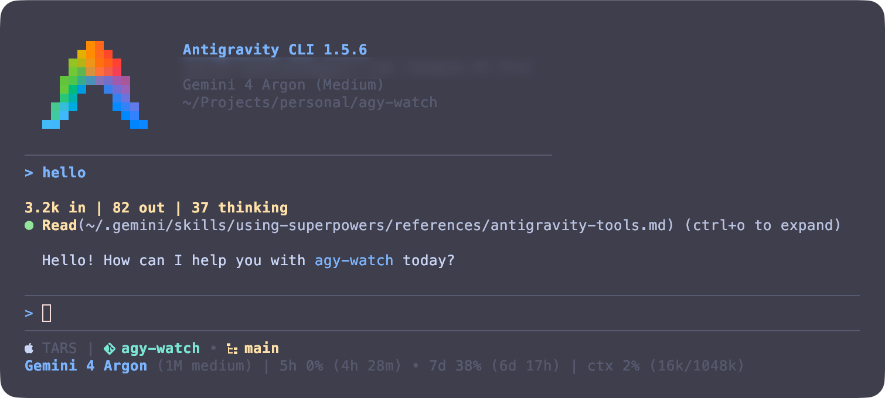

# agy-watch



## Installation

**1. Copy the script**

```sh
mkdir -p ~/.gemini
cp statusline-command.sh ~/.gemini/statusline-command.sh
chmod +x ~/.gemini/statusline-command.sh
```

**2. Merge `settings.json` into `~/.gemini/antigravity-cli/settings.json`**

Add the `statusLine` block to your existing `~/.gemini/antigravity-cli/settings.json`:

```json
"statusLine": {
   "type": "command",
   "command": "bash ~/.gemini/statusline-command.sh"
}
```

## How it works

- **`statusline-command.sh`** — reads the JSON piped by `agy` and renders two lines using the terminal's 16 ANSI colors (adapting automatically to light and dark themes).
  - **Line 1:** platform icon + hostname, current `zmx` session (when active), then repo, worktree, branch and subdirectory, each with its own Nerd Font glyph.
  - **Line 2:** model name and effort (`1M medium`), quota usage windows (`5h` and `7d`, automatically selecting the model-specific weekly bucket such as `gemini-argon-wtu-weekly` / `gemini-carbon-wtu-weekly` / `3p-weekly` / `gemini-weekly` based on the active model) with countdowns to each reset, and context window usage (`ctx`).
- **`settings.json`** — wires up the statusline command.

## Dependencies

- `jq`
- `git` (optional, for branch/worktree display)
- `zmx` (optional, for session name display)
- [Nerd Fonts](https://www.nerdfonts.com/) (for the platform, repo, worktree, branch and folder icons)
